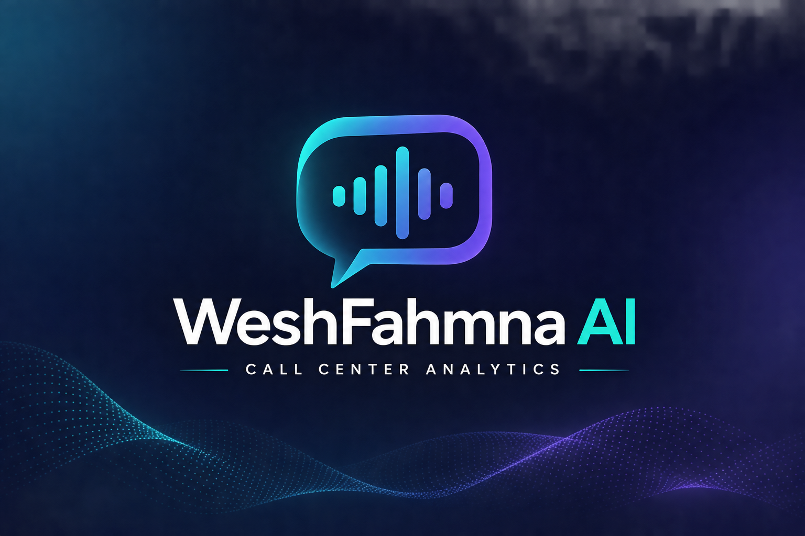
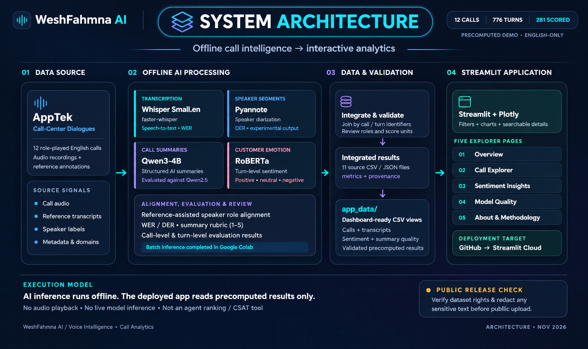
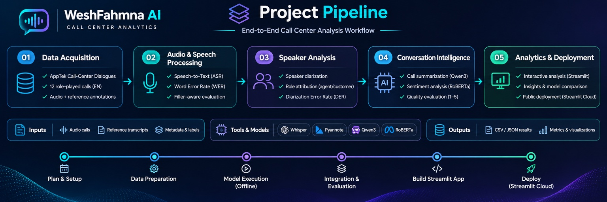

<h1 align="center">WeshFahmna AI | وش فهمنا؟</h1>

<p align="center">
  <strong>AI-Powered Call Center Conversation Intelligence</strong><br>
  Turning customer-service conversations into structured summaries, sentiment insights, and auditable model-quality results.
</p>

<p align="center">
  
</p>

<h2 align="center">
  <a href="https://weshfahmna-ai.streamlit.app/">
     Explore the Live Dashboard  ↗
  </a>
</h2>

> **Project scope:** This is a **12-call evaluation and visualization prototype**, rather than a live call-monitoring system. Speech processing and language-model inference are performed **offline**; the Streamlit dashboard reads prepared results. The original dataset consists of **role-played English customer-service calls**, not private customer recordings.

---

## Table of Contents

| # | Section | Description |
|:--:|---|---|
| 01 | [Overview](#overview) | What WeshFahmna AI does |
| 02 | [Project Problem](#project-problem) | Why conversation analysis matters |
| 03 | [Key Features](#key-features) | Main analytical capabilities |
| 04 | [System Architecture](#system-architecture) | Offline processing and dashboard layers |
| 05 | [AI Pipeline](#ai-pipeline) | From recordings to insights |
| 06 | [Dataset & Scope](#dataset--scope) | Public data source and pilot coverage |
| 07 | [Models & Tech Stack](#models--tech-stack) | Speech, diarization, NLP, and visualization |
| 08 | [Interactive Dashboard](#interactive-dashboard) | Features and analytical views |
| 09 | [Evaluation Results](#evaluation-results) | Measured model quality and sentiment statistics |
| 10 | [Reproducibility](#reproducibility) | Structured outputs and processing documentation |
| 11 | [Limitations](#limitations) | Scope and model reliability considerations |
| 12 | [Data License & Attribution](#data-license--attribution) | Dataset credit and permitted uses |
| 13 | [Author](#author) | Project owner |

---

## Overview

**WeshFahmna AI | وش فهمنا؟** is an end-to-end AI project that explores how customer-service conversations can be transformed into understandable, reviewable insights.

The pipeline combines **automatic speech recognition**, **speaker diarization**, **structured call summarization**, and **customer sentiment analysis**. Its outputs are joined into a Streamlit dashboard for examining individual calls, overall conversation trends, and model reliability.

Instead of presenting AI predictions without context, the project also reports **Word Error Rate (WER)**, **Diarization Error Rate (DER)**, model-comparison scores, and data-provenance notes. This makes the difference between **what the system inferred** and **what the reference data supports** explicit.

### At a Glance

| 12 Calls Analyzed | 118.83 Minutes | 776 Speaker Turns | 281 Customer Turns Scored |
|:---:|:---:|:---:|:---:|
| **8 Service Domains** | **4 Accent Groups** | **2 Summarization Models Compared** | **5 Dashboard Pages** |

---

## Project Problem

Long customer-service calls contain useful information, but reviewing them individually is time-consuming.

Critical details can be scattered across many turns:

- Why the customer called.
- What the agent did.
- What outcome was reached.
- How the customer's language changed during the interaction.

A useful analysis tool should organize these details while also exposing uncertainty.

Errors in transcription, speaker attribution, and generated summaries can affect downstream interpretation.

WeshFahmna AI therefore treats **model quality and traceability** as part of the product, not an afterthought.

---

## Key Features

| Capability | What It Provides |
|---|---|
| **Call Summarization** | Structured customer issue, agent action, and outcome/next-step fields from Qwen models |
| **Speech Transcription** | English ASR outputs generated with faster-whisper (`small.en`) |
| **Speaker Analysis** | Diarization experiments, timestamped turns, and reviewable attribution results |
| **Customer Sentiment** | Call-level sentiment, customer-turn classification, and beginning-to-end comparisons |
| **Interactive Exploration** | Searchable calls, filters, transcripts, evidence, and sentiment timelines |
| **Quality Evaluation** | Per-call WER/DER, adjusted WER, and Qwen2.5-versus-Qwen3 quality comparisons |
| **Reproducible Outputs** | Structured CSV/JSON exports, methodology notes, and provenance metadata |

---

## System Architecture

WeshFahmna AI follows a modular architecture that separates **compute-intensive offline AI processing** from the **lightweight Streamlit analytics interface**.

This design allows users to explore precomputed results without downloading large AI models or reprocessing the original audio recordings.

<p align="center">
  
</p>

### Architecture Components

**1. Data Source**

The system uses the AppTek Call-Center Dialogues dataset, which provides English-language customer-service conversations with reference transcripts, speaker annotations, and metadata.

**2. Offline AI Processing**

The analysis pipeline integrates several AI models:

- Whisper for automatic speech recognition.
- Pyannote for speaker diarization.
- Qwen for structured call summarization.
- RoBERTa for customer sentiment classification.

**3. Data Integration & Validation**

Model outputs are integrated into structured CSV and JSON files.

This layer handles:

- Call and transcript alignment.
- Reference-assisted speaker-role attribution.
- Model evaluation metrics.
- Data validation and consistency checks.
- Provenance and methodology documentation.

**4. Streamlit Application**

The prepared outputs are loaded into an interactive dashboard for call exploration, sentiment visualization, and model-quality assessment.

> **Execution Model:** AI inference is performed offline using Google Colab. The deployed Streamlit application reads precomputed results and does not execute ASR, diarization, or LLM inference during dashboard interaction.

> **Speaker Attribution:** The dashboard uses reference-assisted customer/agent labels where available. Raw speaker diarization is evaluated separately.

---

## AI Pipeline

The project follows an end-to-end workflow from dataset acquisition to interactive visualization.

<p align="center">
  
</p>

### Processing Workflow

**Stage 1 — Data Acquisition**

- Explore publicly available call-center datasets.
- Select the AppTek Call-Center Dialogues dataset.
- Inspect reference transcripts, speaker labels, and audio metadata.
- Select 12 English-language conversations for evaluation.

**Stage 2 — Audio & Speech Processing**

- Transcribe calls using faster-whisper.
- Compare generated transcripts against reference annotations.
- Calculate Word Error Rate (WER).
- Evaluate filler-adjusted transcription accuracy.

**Stage 3 — Speaker Analysis**

- Apply Pyannote speaker diarization.
- Analyze speaker segmentation quality.
- Calculate Diarization Error Rate (DER).
- Review speaker attribution against available reference labels.

**Stage 4 — Conversation Intelligence**

- Generate structured summaries using Qwen.
- Extract customer issues, agent actions, and outcomes.
- Classify customer sentiment using RoBERTa.
- Evaluate summaries for factual accuracy, completeness, and outcome accuracy.

**Stage 5 — Analytics & Deployment**

- Integrate processed results.
- Validate structured CSV/JSON outputs.
- Build interactive visualizations using Streamlit and Plotly.
- Prepare the application for deployment through Streamlit Community Cloud.

---

## Dataset & Scope

### Data Source

Reviewed 16 datasets and 15 research papers to select a suitable dataset for this project.

**[View Dataset Research Survey (Excel)](docs/research_survey.xlsx)**

The project uses the publicly available:

**[AppTek Call-Center Dialogues Dataset](https://huggingface.co/datasets/apptek-com/apptek_callcenter_dialogues)**

Developed and published by **AppTek.ai**.

The dataset contains role-played English customer-service conversations with speaker annotations, transcripts, and associated metadata.

The project uses the **`diarization` configuration**.

### Dataset Characteristics

| Characteristic | Value |
|---|---|
| Dataset | AppTek Call-Center Dialogues |
| Language | English |
| Conversation Type | Role-played customer-service calls |
| Selected Calls | 12 |
| Sampling Seed | 42 |
| Total Duration | 118.83 minutes |
| Average Call Duration | 9.90 minutes |
| Service Domains | 8 |
| Accent Groups | 4 |
| Speaker Turns | 776 |
| Scored Customer Turns | 281 |

The selected calls represent a small evaluation sample rather than the complete dataset.

---

## Models & Tech Stack

### AI Models

| Task | Model | Purpose |
|---|---|---|
| Speech Recognition | faster-whisper `small.en` | Audio transcription |
| Speaker Diarization | Pyannote Audio | Speaker segmentation |
| Call Summarization | Qwen2.5-3B-Instruct | Baseline summarization |
| Call Summarization | Qwen3-4B-Instruct-2507 | Structured summaries and comparison |
| Sentiment Analysis | Twitter-RoBERTa | Customer sentiment classification |

### Data Processing

- Python
- Pandas
- NumPy
- CSV / JSON
- Google Colab

### Frontend & Visualization

- Streamlit
- Plotly
- Interactive dashboards
- Searchable conversation views
- Sentiment timeline visualization

### Evaluation

- Word Error Rate (WER)
- Filler-Adjusted WER
- Diarization Error Rate (DER)
- Structured Summary Quality Evaluation
- Sentiment Distribution Analysis

### Development & Deployment

- Git
- GitHub
- Google Colab
- Streamlit Community Cloud

---

## Interactive Dashboard

WeshFahmna AI includes an interactive analytics application designed to transform model outputs into understandable insights.

<h3 align="center">
  <a href="https://weshfahmna-ai.streamlit.app/">
     Explore the Interactive Dashboard  ↗
  </a>
</h3>

### 1. Overview

The Overview page presents high-level statistics about the analyzed conversations.

Key components include:

- Total analyzed calls.
- Total recording duration.
- Average call duration.
- Service-domain distribution.
- Accent distribution.
- Overall customer sentiment.
- Sentiment transitions.

### 2. Call Explorer

The Call Explorer provides detailed analysis for individual conversations.

Users can inspect:

- Call metadata.
- Customer issue.
- Agent action.
- Final outcome or next step.
- AI-generated summary.
- Timestamped transcript.
- Customer sentiment.
- Model-quality indicators.

### 3. Sentiment Insights

The Sentiment Insights page visualizes customer emotions throughout analyzed conversations.

It includes:

- Positive, neutral, and negative sentiment distributions.
- Customer-turn sentiment classification.
- Sentiment timelines.
- Beginning-to-end comparisons.
- Sentiment probability scores.

### 4. Model Quality

The Model Quality page presents evaluation results for the AI pipeline.

It includes:

- Speech recognition accuracy.
- Original versus filler-adjusted WER.
- Speaker diarization performance.
- Qwen2.5 versus Qwen3 summarization quality.
- Call-level evaluation results.

### 5. About & Methodology

The methodology section documents:

- Dataset selection.
- AI models.
- Processing stages.
- Evaluation procedures.
- Data limitations.
- Interpretation guidance.

---

## Evaluation Results

The following results were obtained from the selected **12-call evaluation sample**.

### Speech Recognition Evaluation

| Evaluation Metric | Average Result |
|---|---:|
| Original Word Error Rate | **20.85%** |
| Filler-Adjusted Word Error Rate | **18.24%** |
| Improvement | **2.61 percentage points** |

The filler-adjusted evaluation reduces the impact of selected filler-word mismatches.

However, filler-adjusted WER is a modified metric and should not be treated as directly equivalent to standard WER.

### Speaker Diarization Evaluation

| Evaluation Metric | Result |
|---|---:|
| Average Diarization Error Rate | **19.93%** |

Speaker diarization performance varies across conversations.

Some calls exhibit considerably higher errors, emphasizing the importance of reference-assisted role attribution and human review.

### Summarization Model Comparison

Two Qwen models were evaluated using structured quality criteria.

| Model | Average Quality Score |
|---|---:|
| Qwen2.5-3B-Instruct | **3.31 / 5** |
| Qwen3-4B-Instruct-2507 | **3.83 / 5** |
| Average Improvement | **+0.53 / 5** |

Evaluation criteria included:

- Factual accuracy.
- Information completeness.
- Outcome accuracy.

Qwen3 achieved a higher average evaluation score across the pilot.

However, Qwen2.5 performed better on four individual calls, with one tie.

These scores reflect a limited-sample evaluation rather than guaranteed model performance across all conversations.

### Customer Sentiment Analysis

#### Overall Call Sentiment

| Sentiment | Number of Calls |
|---|---:|
| Positive | 4 |
| Neutral | 8 |
| Negative | 0 |

#### Customer-Turn Sentiment

| Sentiment | Number of Turns |
|---|---:|
| Positive | 79 |
| Neutral | 181 |
| Negative | 21 |
| **Total** | **281** |

#### Opening-to-Closing Sentiment

| Sentiment Transition | Calls |
|---|---:|
| Neutral → Positive | 6 |
| Neutral → Neutral | 3 |
| Positive → Neutral | 2 |
| Positive → Positive | 1 |

> **Important:** Call-level and turn-level sentiment distributions represent different units of analysis. Sentiment classification does not establish verified customer satisfaction or issue resolution.

---

## Reproducibility

The project stores intermediate and final results in structured, reusable formats.

### Main Output Files

| File | Description |
|---|---|
| `calls.csv` | Call-level information and evaluation metrics |
| `calls.json` | Structured call records and detailed analysis |
| `speaker_turns.csv` | Timestamped speaker transcripts |
| `customer_turn_sentiment.csv` | Customer sentiment predictions |
| `diarization_metrics.csv` | Speaker diarization evaluation |
| `filler_adjusted_wer.csv` | Speech recognition metric comparison |
| `model_quality_comparison_12_calls.csv` | Summarization model comparison |
| `final_quality_metrics.csv` | Aggregated model-quality metrics |
| `speaker_attribution_review.csv` | Speaker-label alignment review |
| `methodology.json` | Processing and evaluation methodology |
| `provenance.json` | Data provenance and model information |

### Application Data Preparation

The application uses prepared analytical datasets located in:

`app_data/`

These datasets support:

- Call exploration.
- Transcript visualization.
- Sentiment timelines.
- Model-quality comparisons.
- Dashboard statistics.

Prepared views can be regenerated using:

```bash
python scripts/prepare_data.py
```

The dashboard does not rerun the original AI models when displaying previously processed results.

---

## Limitations

Although WeshFahmna AI demonstrates an end-to-end conversation analysis pipeline, several limitations should be considered.

### Dataset Limitations

- The evaluation uses only 12 conversations.
- The original recordings are role-played rather than real customer interactions.
- The dataset represents a limited selection of accents and service domains.

### Speech Recognition

- Automatic transcription can introduce word substitutions, deletions, and insertions.
- Recognition accuracy varies across individual calls.
- Transcription errors can influence downstream NLP tasks.

### Speaker Diarization

- Speaker segmentation is not perfectly accurate.
- Some conversations exhibit relatively high DER.
- Reference annotations assist customer/agent role identification.

### Sentiment Analysis

- Sentiment predictions are generated automatically.
- Neutral sentiment does not necessarily indicate customer satisfaction.
- Sentiment classification is not a substitute for customer satisfaction surveys.

### Summarization

- Language models can omit details or generate inaccurate statements.
- Summary quality varies across conversations.
- Human review remains important for high-stakes applications.

---

## Data License & Attribution

This project uses the publicly available **AppTek Call-Center Dialogues** dataset.

**Dataset Provider:** AppTek.ai

**Dataset Source:**

[AppTek Call-Center Dialogues — Hugging Face](https://huggingface.co/datasets/apptek-com/apptek_callcenter_dialogues)

**Dataset License:**

Creative Commons Attribution-ShareAlike 4.0 International (CC BY-SA 4.0).

[View License](https://creativecommons.org/licenses/by-sa/4.0/)

The dataset is used for research, evaluation, and educational analysis.

The original dataset is intended for evaluation and analysis rather than training or fine-tuning foundation models.

Any redistribution of original or adapted dataset materials must follow the applicable dataset license and attribution requirements.

The dataset license does not automatically determine the license of independently developed application source code.

---

## Project Purpose

WeshFahmna AI demonstrates the practical integration of multiple AI technologies into a unified conversation analytics workflow.

The project showcases:

- Speech recognition.
- Speaker diarization.
- Natural Language Processing.
- Large Language Models.
- Customer sentiment analysis.
- AI evaluation and benchmarking.
- Structured data engineering.
- Interactive data visualization.
- Reproducible AI experimentation.
- Streamlit application development.

Its primary objective is to explore how AI-generated conversation insights can be presented in a transparent, interpretable, and accessible format.

---

## Author

**Yasir Aladwani**

AI Engineer | Data Science & Machine Learning

**LinkedIn:**  
[linkedin.com/in/yasir-aladwani-99669a402](https://www.linkedin.com/in/yasir-aladwani-99669a402)

**GitHub:**  
[github.com/Yasir-Aladwani](https://github.com/Yasir-Aladwani)

---

<p align="center">
  <strong>WeshFahmna AI</strong><br>
  <em>From Conversations to Clarity.</em>
</p>
